

<a href="README.md">Português</a> · <a href="README.en.md">English</a> · <strong>Español</strong>

Central multicuenta para Poke Idle World · Windows x64 · Versión 1.0.0

<a href="https://github.com/Diego-ops501/Quadrymon/releases/download/v1.0.0/Quadrymon-1.0.0-x64.exe"><strong>Descargar Quadrymon 1.0.0</strong></a> · <a href="https://github.com/Diego-ops501/Quadrymon/releases/latest">Última versión</a>

**Cuatro cuentas, mercado global, inventario y análisis de hunts en una aplicación.** Quadrymon reúne herramientas para seguir tus cuentas, comparar oportunidades y elegir dónde entrenar a tu Pokémon.

La ilustración de presentación fue creada a partir de la referencia visual de Quadrymon. Las capturas inferiores muestran la interfaz real en portugués con cuentas, inventarios y valores de demostración; no representan resultados garantizados de farm.

## Instalación y primeros pasos

1. Descarga **Quadrymon-1.0.0-x64.exe** desde el enlace superior.
2. Ejecuta el instalador y elige el idioma y la carpeta de instalación.
3. Abre **Ajustes → Cuentas** (Ajustes → Contas), añade hasta cuatro cuentas y guarda.
4. La app completa el correo o usuario y la contraseña al cargar cada cuenta. Pulsa **Entrar en las cuentas** para enviar los formularios. Completa CAPTCHA y autenticación adicional en el juego.
5. Elige **Cuadrícula**, **Foco** o **Resumen**. Selecciona el idioma en **Ajustes → Aspecto y juego**.

Se necesita Windows x64 y acceso a internet. El instalador incluye el entorno de ejecución; no necesitas Node.js para usar la aplicación.

## Multicuenta y controles

Las cuentas utilizan sesiones separadas. La barra superior permite seleccionar una cuenta, cambiar de vista y recargar todas las páginas con la flecha circular junto a las cuentas.

| Control | Función |
| --- | --- |
| **Cuadrícula** | Observar los paneles del juego uno junto a otro. |
| **Foco** | Ampliar una cuenta y mantener abiertas las demás sesiones. |
| **Resumen** | Consultar hunt, líder, HP, XP/h, $/h, capturas y bajas/h. |
| **− / +** | Ajustar el zoom de una cuenta. |
| **⟳ en un panel** | Recargar solo esa cuenta. |
| **⟳ junto a las cuentas** | Recargar todas las cuentas configuradas. |
| **Botón de encendido** | Apagar o volver a encender el panel de una cuenta. |

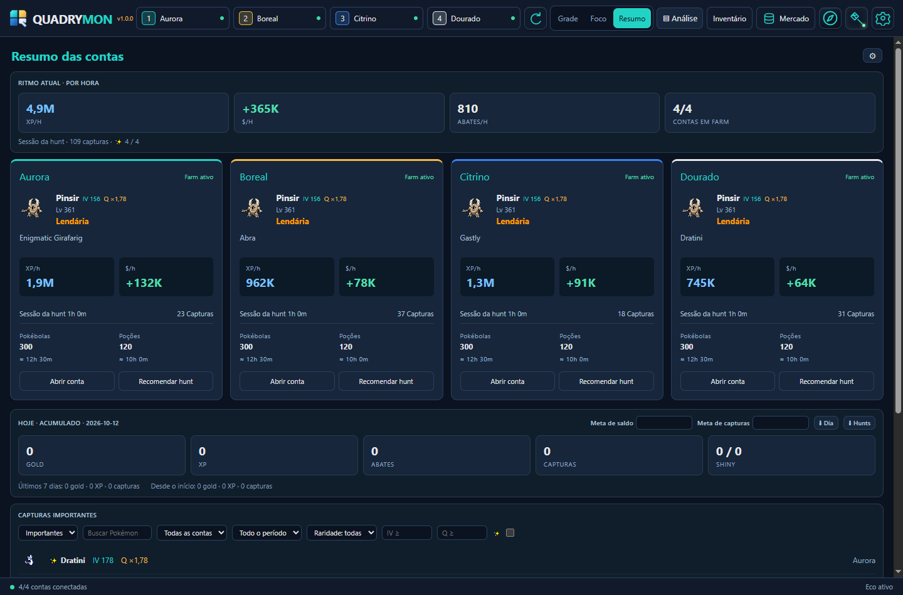

Cambiar de vista conserva las sesiones. Elige cuántos paneles usar en **Ajustes → Cuentas**.

## Análisis e historial de capturas

Abre **Análisis** para seguir los indicadores de las cuentas en el panel lateral. El resumen y el análisis muestran datos observados de la sesión; los datos ausentes no significan rendimiento cero.

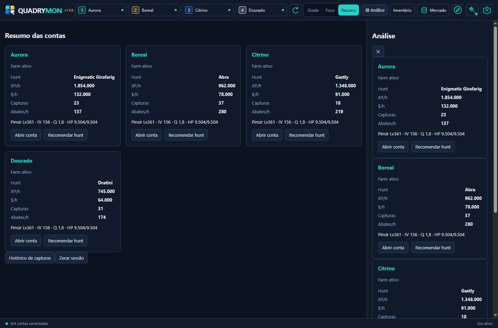

El **Historial de capturas** reúne los Pokémon registrados por la aplicación. Filtra por cuenta, nombre, rareza, IV mínimo y shiny. Exporta CSV para consultar el historial en una hoja de cálculo. **Reiniciar sesión** reinicia los indicadores.

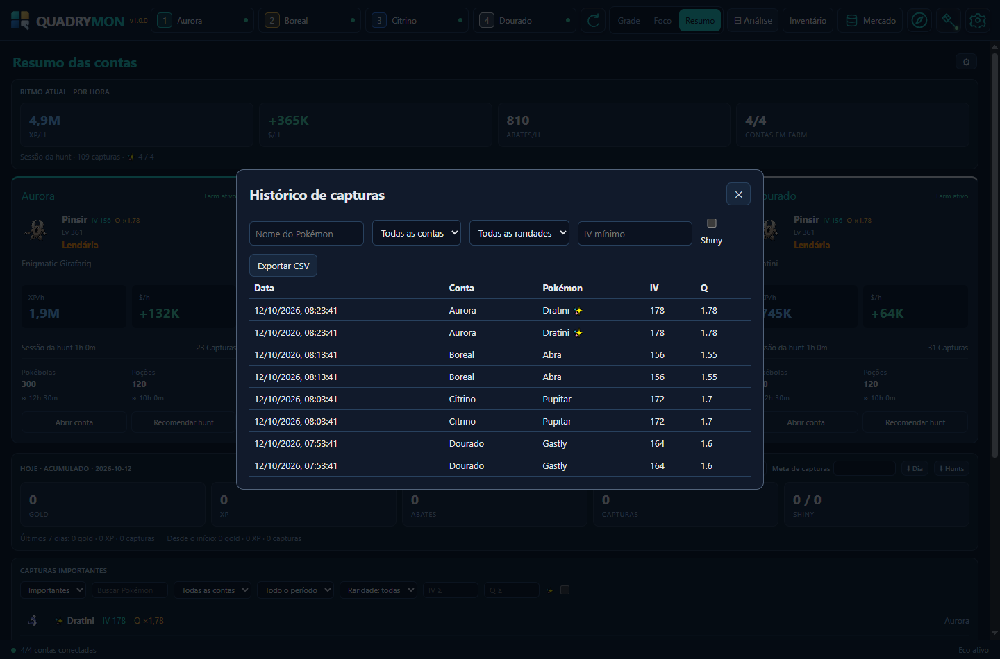

## Mercado global

El botón superior **Mercado** abre la consulta integrada de precios sin salir de una hunt. Elige cuenta, categoría y vista de **Tarjetas** o **Filas**. Para Pokémon, filtra por shiny, IV, nivel, calidad, tipo y rareza. Las compras, ventas y negociaciones se realizan en el mercado del propio juego.

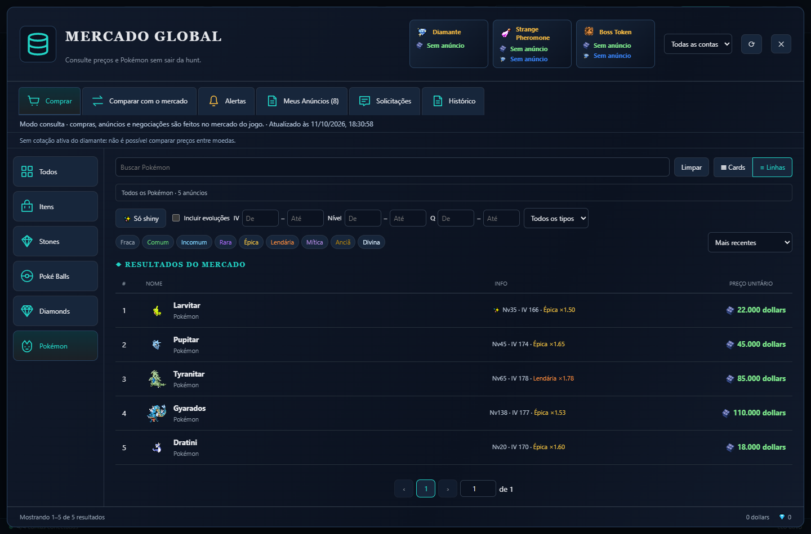

### Sugerencias y evoluciones

Mientras escribes, el catálogo de Pokémon y objetos ofrece nombres e imágenes. Cuando el catálogo está en caché, las sugerencias no necesitan esperar a que carguen los anuncios.

Las sugerencias agrupan variantes y niveles bajo el nombre de la especie, evitando opciones repetidas como “Dratini Lv.1” y “Nightmare Dratini”. Con **Incluir evoluciones** activado, buscar Pupitar también considera Larvitar y Tyranitar, manteniendo los demás filtros.

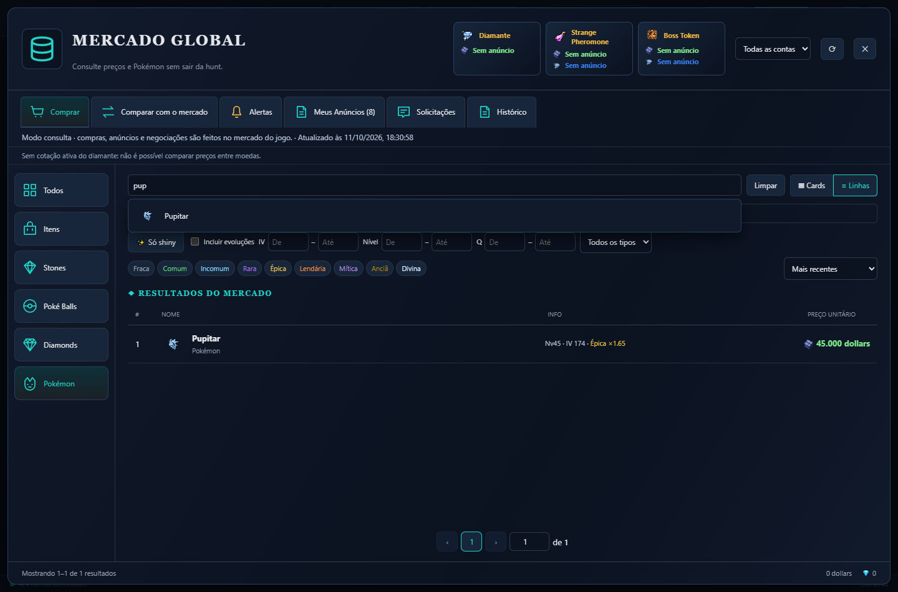

### Herramientas del mercado

| Pestaña | Función |
| --- | --- |
| **Comprar** | Consultar ofertas y ordenar resultados. |
| **Comparar con el mercado** | Elegir un objeto o Pokémon del inventario y consultar anuncios similares. |
| **Alertas** | Configurar condiciones de precio y notificaciones de mercado. |
| **Mis Anuncios** | Seguir los anuncios disponibles para la cuenta seleccionada. |
| **Solicitudes** | Consultar solicitudes de compra. |
| **Historial** | Consultar registros devueltos por el juego. |

Las comparaciones usan las condiciones disponibles, como especie, shiny, rareza, nivel, IV y calidad. Convertir monedas requiere una cotización activa del diamante; sin ella, la aplicación indica que no es posible comparar precios entre monedas.

### Ir al mercado y volver a una hunt

**Ir al mercado**, en el panel de una cuenta, realiza el viaje dentro del juego. Es diferente del botón superior que abre la consulta de precios. Si la cuenta está fuera de una hunt y existe una hunt anterior registrada, el atajo permite regresar a ella incluso desde otra ubicación.

## Inventario e IVs

Abre **Inventario** para consultar Pokémon, objetos y Poké Balls en columnas separadas por cuenta. Usa categorías y filtros de nombre, cuenta, rareza e intervalo de IV. **Actualizar** solicita una nueva lectura del inventario.

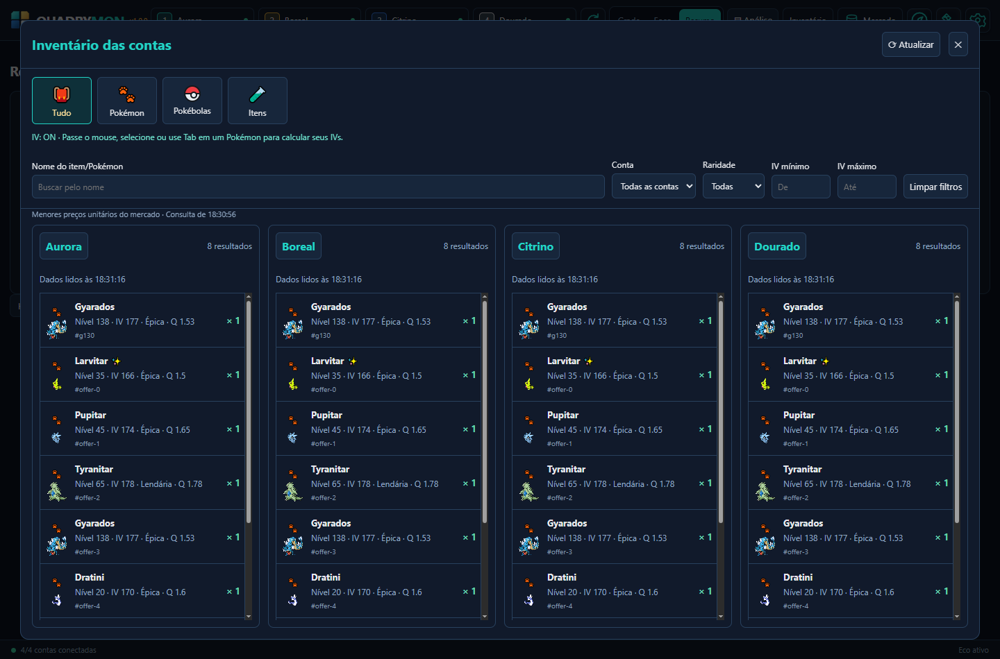

Con la herramienta de IV activada, pasa el ratón, selecciona o usa Tab para llegar a un Pokémon. La tarjeta muestra nivel, calidad, tipos, atributos e IVs individuales; **Simular nivel** proyecta los atributos en otro nivel.

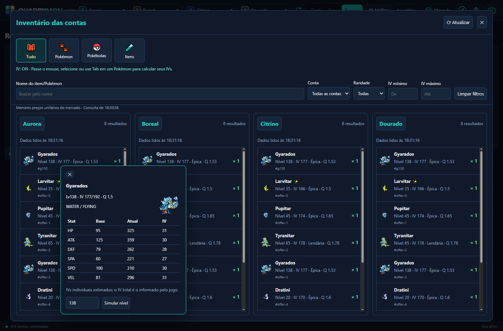

El **IV total** lo informa el juego. Los **IVs individuales** se deducen de los atributos disponibles y pueden ser estimaciones. El cálculo necesita que el juego proporcione los datos necesarios.

## Recomendaciones de hunt

Abre el icono de hunt o **Recomendar hunt** en el resumen. Elige cuenta, objetivo de XP o beneficio, opción de poción y umbral de HP. El análisis considera nivel del líder, atributos, movimientos disponibles, efectividad, datos de hunts y mediciones de la cuenta.

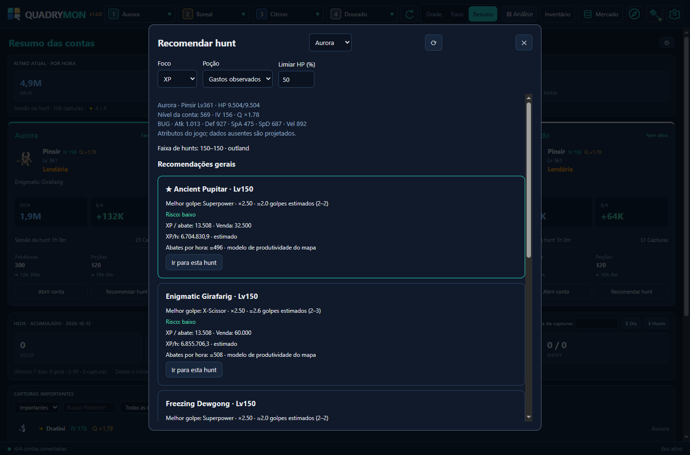

Los resultados distinguen valores **medidos** y **estimados**. Una muestra utiliza al menos cinco minutos limpios de observación; cambiar de líder, subir de nivel o reiniciar los contadores cambia la referencia de la medición.

La progresión limita las opciones: por debajo del nivel 150, se respeta el nivel del Pokémon; de 150 a 599, se utilizan hunts de la franja 150; a partir de 600, se considera Orre 500–600 cuando está disponible. La hunt del tipo del día aparece cuando el juego informa de un evento activo y existe una opción adecuada.

El XP por baja y el valor base de venta proceden del catálogo del juego. Componentes ausentes, como la probabilidad de captura, pueden impedir una proyección completa del beneficio. El XP/h, los golpes y el riesgo estimados deben comprobarse en combate real; no garantizan el rendimiento.

## Alertas, sonido y overlay

En **Ajustes → Avisos del farm**, selecciona alertas, voz, sonido de shiny y capturas de pantalla de shiny. Un webhook opcional permite enviar notificaciones a tu Discord.

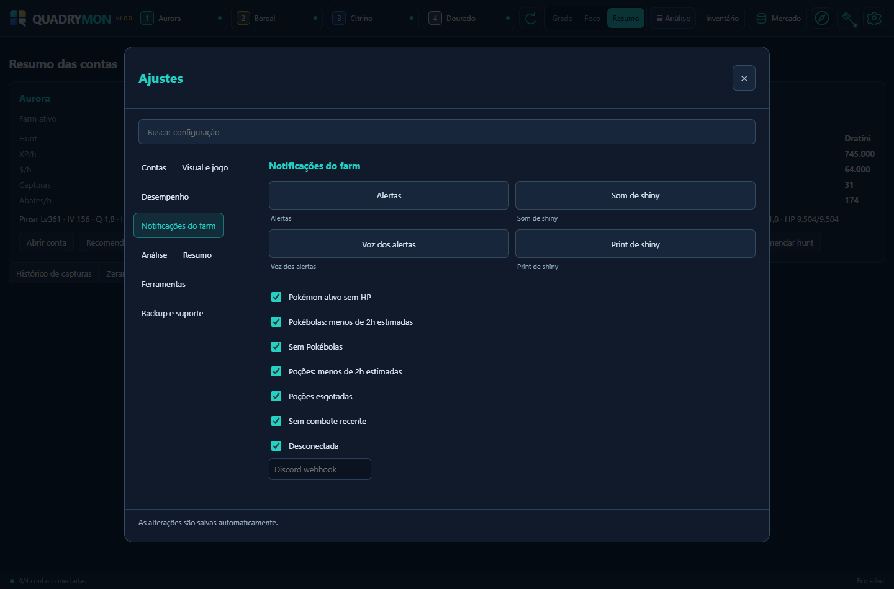

En **Aspecto y juego**, activa el **Overlay** para ver un resumen compacto de las cuentas en una ventana flotante. Las notificaciones requieren conexión y recepción de eventos del juego.

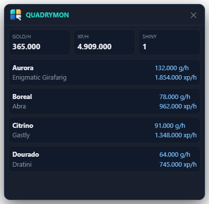

## Ajustes y herramientas

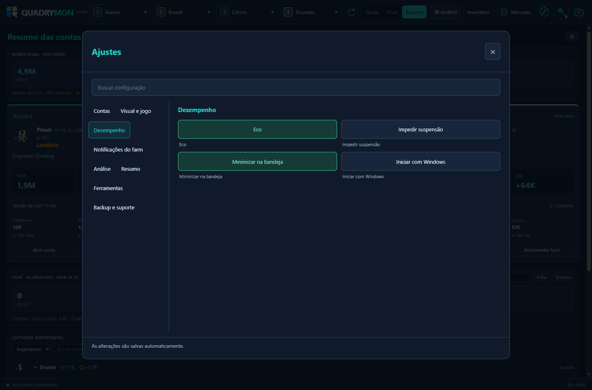

- **Eco:** reduce la frecuencia de cuadros de los paneles según la vista activa.
- **Aspecto y juego:** idioma, proporción del juego, chat, menú del juego, HUD y sonido.
- **Evitar suspensión:** mantiene activo el equipo mientras la opción está activada.
- **Bandeja e inicio:** minimiza en la bandeja y elige iniciar con Windows.
- **Venta protegida:** añade confirmación a las acciones de venta interceptadas por la aplicación.
- **Tierlist y Ditto:** consulta movimientos aprendidos y atributos proyectados. Ordenar por potencia no sustituye las recomendaciones de hunt.
- **Backup y soporte:** exporta o importa ajustes, abre el manual y consulta el informe de errores.

El sistema operativo cifra las credenciales en el perfil local. La exportación de ajustes excluye contraseñas, sesiones del juego y webhook. Quadrymon mantiene compatibilidad con el perfil local existente de la aplicación.

## Atajos

| Atajo | Acción |
| --- | --- |
| **Ctrl + 1 / 2 / 3 / 4** | Poner en foco la cuenta correspondiente. |
| **Ctrl + M** | Alternar el sonido de las cuentas. |

## Actualizaciones

Las publicaciones están en la [página de versiones](https://github.com/Diego-ops501/Quadrymon/releases). Usa **Ajustes → Backup y soporte → Buscar actualización**. La aplicación solicita confirmación antes de descargar y antes de instalar una actualización.

## Ejecutar y compilar desde el código

Para desarrollo, utiliza Node.js 24 y npm:

    npm ci
    npm start

Para verificar el código y generar el instalador:

    npm test
    npm run dist

El instalador de Windows se genera en <code>dist/</code>. <code>npm run docs:screenshots</code> recrea las imágenes de documentación en un perfil temporal con datos de demostración, sin acceder a cuentas reales.

Desarrollo y mantenimiento: **Diego-ops501**. El código propio de Quadrymon se distribuye bajo la [licencia MIT](LICENSE). Las dependencias y los recursos de terceros mantienen sus propias condiciones y avisos.
